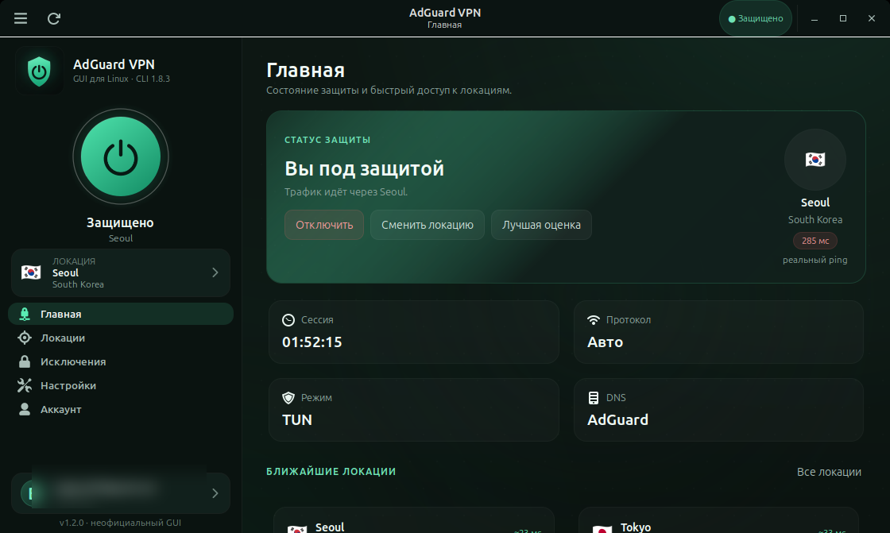
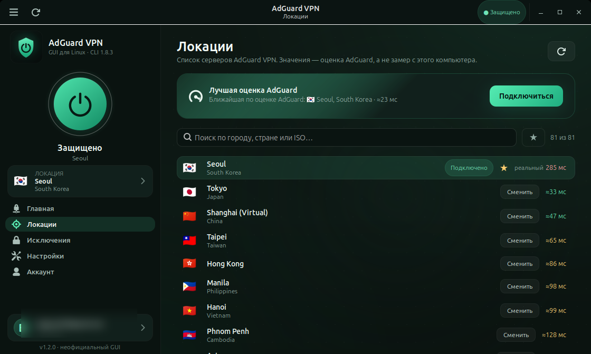

# AdGuard VPN GUI

Неофициальный графический интерфейс для официального `adguardvpn-cli` на Linux.
Python 3 + GTK3, тёмная тема, трей, графический запрос пароля root.

Проект не связан с AdGuard Software Ltd. Это локальная оболочка над официальным CLI.

## Авторы

- **DeepSeek V4.1 Flash** (OpenCode) — основной разработчик: код, интерфейс, упаковка, тесты.
- **MiMo-V2.6-Flash** — скаутинг, архитектурные рекомендации и независимое ревью.
- [**boikov1977**](https://github.com/boikov1977) — владелец проекта, постановка задач, тестирование и публикация.

Проект сделан в паре «человек + ИИ». Юридическим владельцем и мейнтейнером
репозитория остаётся boikov1977.

## Возможности

- Подключение и отключение VPN, смена локации.
- Список локаций с поиском по городу, стране и ISO-коду.
- **Честный ping:** значения из `list-locations` помечены как оценка AdGuard (`≈`);
  реальный ping активного сервера берётся из `tunnel.log` и подписан «реальный».
- **История замеров:** для посещённых локаций показывается последний реальный ping
  с датой (`231 мс · 22.11`), без смешивания с оценкой.
- Исключения: общий и выборочный режимы, добавление, удаление, очистка.
- **Список UnRKN:** загрузка списка сайтов, не любящих VPN (например, `ozon.ru`),
  и добавление их в исключения общего режима.
- Настройки CLI: режим TUN/SOCKS, протокол, DNS, маршрутизация, post-quantum и др.
- Аккаунт: лицензия, план, устройства, срок действия, вход через терминал.
- Трей: свернуть/показать, подключить/отключить, выход, подменю «Локации»
  с избранными и недавними серверами.
- **Избранные локации:** закрепление звёздочкой (ПКМ по строке), фильтр
  «Только избранные», приоритет в быстрых карточках и меню трея.
- **Адаптивный интерфейс:** раскладка подстраивается под размер окна и экрана —
  от 1366×768 до широких мониторов; карточки перестраиваются в 1, 2 или 4 колонки.
- **Экономичный мониторинг:** статус опрашивается раз в 30 с при открытом окне
  и раз в 120 с в трее; изменения `vpn.pid`/`vpn.socket` подхватываются сразу.
- **Русский и английский интерфейс** через gettext; английский каталог в
  `agvpn/locale/`.
- Автозапуск GUI при входе в систему и опциональное подключение VPN при старте.
- Обновление CLI и экспорт журналов прямо из приложения.
- Графический askpass для sudo: пароль root вводится в тёмном диалоге и нигде не сохраняется.

## Скриншоты




## Требования

- Linux с GTK3 (проверено на Linux Mint 22.2 Cinnamon).
- Python 3.10+, PyGObject (`python3-gi`) и Cairo (`python3-cairo`, `python3-gi-cairo`).
- Официальный `adguardvpn-cli` (AdGuard VPN CLI).
- Для трея: `gir1.2-ayatanaappindicator3-0.1` (без него приложение работает, но без иконки в лотке).

Установка зависимостей (Debian/Ubuntu/Mint):

```bash
sudo apt install python3 python3-gi python3-cairo python3-gi-cairo \
                 gir1.2-ayatanaappindicator3-0.1
```

## Установка

Есть два взаимоисключающих способа. Для обычного использования выбирайте
**`.deb`**; `install.sh` нужен для разработки и запуска прямо из репозитория.

### Вариант 1 — готовый .deb (рекомендуется)

Скачайте `adguard-vpn-gui_1.2.1_all.deb` со страницы
[Releases](https://github.com/boikov1977/adguard-vpn-gui/releases) и установите:

```bash
sudo apt install ./adguard-vpn-gui_1.2.1_all.deb
```

Пакет ставит приложение в `/usr/lib/adguard-vpn-gui`, лаунчер в
`/usr/bin/adguard-vpn-gui`, пункт меню, иконки и AppStream-метаданные.
Обновление: скачайте новый `.deb` из Releases и установите его поверх
(`apt install ./...`). Удаление — обычной командой:

```bash
sudo apt remove adguard-vpn-gui
```

### Вариант 2 — из исходников, без root

```bash
git clone https://github.com/boikov1977/adguard-vpn-gui.git
cd adguard-vpn-gui
./install.sh
```

Скрипт создаёт пункт меню, иконки в `~/.local/share/icons/hicolor/` и ярлык
на рабочем столе (`~/Рабочий стол` или `~/Desktop` — по `XDG_DESKTOP_DIR`).
Всё устанавливается в домашний каталог, root не нужен. Ярлык на рабочем столе
можно не создавать:

```bash
./install.sh --no-desktop
```

Запуск: меню приложений → **AdGuard VPN** или двойной клик по ярлыку.
Запуск из исходников вообще без установки:

```bash
python3 adguard-vpn-gui.py
```

> Не устанавливайте `.deb` и `install.sh` одновременно: в меню появятся два
> пункта «AdGuard VPN». Выберите один способ.

## Первый запуск

1. Войдите в аккаунт AdGuard: «Аккаунт» → «Войти в терминале» (откроется официальный `adguardvpn-cli login`).
2. Нажмите большую кнопку питания.
3. Введите пароль root в графическом окне — CLI запускает службу через sudo.
   Пароль не сохраняется ни в файлах, ни в логах.

## Честный ping

`adguardvpn-cli list-locations` отдаёт **оценку** AdGuard, а не измерение с вашего
компьютера. Поэтому в списке она подписана `≈17 мс` и снабжена подсказкой.

Для активного подключения CLI пишет в `tunnel.log` реальный замер выбранного
сервера:

```
Using endpoint: name=..., address=..., relay=none, ping=231ms
```

Это значение показывается как «реальный ping» с временем замера и именем сервера.
Если данных нет — показывается `—`, без выдуманных чисел. По локациям, к которым
вы ещё не подключались, реальный IP сервера неизвестен, поэтому там только оценка.

Последний реальный замер сохраняется локально для каждой посещённой локации.
После переключения прежняя строка показывает, например, `231 мс · 22.11` с
подписью «последний замер». Это по-прежнему измерение, а не оценка; записи
старше 7 дней не показываются как актуальные. Кэш никуда не отправляется.

## Сайты, не любящие VPN

В «Исключениях» есть блок со списком UnRKN — сервисы, которые ругаются на
иностранный IP (например, `ozon.ru`). Кнопка «Загрузить с GitHub» скачивает
`ru-blocklist.txt`; «Применить» добавляет сайты в исключения **общего** режима,
чтобы они открывались напрямую, а VPN защищал остальной трафик.

- Если у бренда есть домен `.ru`, остальные зоны (`.by`, `.com`, `.kz`, `.su`…)
  отбрасываются; если `.ru` нет — домен остаётся как есть.
- Можно добавить список к текущим исключениям или заменить их.
- Загрузка идёт только по кнопке, без фонового автообновления; скачанный файл
  кэшируется локально. Прогресс применения виден по партиям, операцию можно
  остановить.
- Источник: `https://github.com/UnRKN/ru-blocklist`.

### Если исключённые сайты не открываются

На системах с `systemd-resolved` (Ubuntu, Mint и др.) `adguardvpn-cli` не видит
системный DNS: он скрыт за заглушкой `127.0.0.53` и пропускается CLI как
потенциальная петля маршрутизации. Если при этом включено «Менять системный
DNS», у исключённых сайтов не остаётся DNS-сервера — соединение обрывается ещё
до загрузки страницы. На странице «Исключения» в этом случае появляется
предупреждение с кнопкой «Отключить смену системного DNS»: настройка
применяется сразу, переподключение не требуется. DNS-запросы после этого идут
напрямую, как и трафик исключённых сайтов; остальной трафик остаётся в VPN.

## Где лежат данные

| Что | Путь |
|---|---|
| Настройки и состояние GUI | `~/.config/adguard-vpn-gui/state.json` |
| Кэш локаций | `~/.cache/adguard-vpn-gui/locations.json` |
| История реальных замеров | `~/.cache/adguard-vpn-gui/endpoints.json` |
| Скачанный список UnRKN | `~/.cache/adguard-vpn-gui/ru-blocklist.json` |
| Журнал GUI | `~/.local/state/adguard-vpn-gui/app.log` |
| Данные официального CLI | `~/.local/share/adguardvpn-cli/` |

## Удаление

```bash
cd ~/adguard-gui
./uninstall.sh
```

Удаляются пункт меню, иконки, ярлык и автозапуск. Настройки, кэш и состояние
сохраняются. Полное удаление:

```bash
./uninstall.sh --purge
```

Данные официального CLI (`~/.local/share/adguardvpn-cli/`) не удаляются.

## Сборка .deb

Пакет для Debian/Ubuntu/Mint собирается без debhelper:

```bash
sudo apt install dpkg-dev rsync   # если ещё не установлены
packaging/build-deb.sh
```

Готовый файл — `dist/adguard-vpn-gui_<версия>_all.deb`; версия читается из
`APP_VERSION` в `agvpn/util.py`. Пакет ставит приложение в
`/usr/lib/adguard-vpn-gui`, лаунчер `/usr/bin/adguard-vpn-gui`, пункт меню,
иконки и метаданные AppStream. Установка:

```bash
sudo apt install ./dist/adguard-vpn-gui_1.2.1_all.deb
```

Пакет зависит от `python3-cairo`, `python3-gi-cairo` и `hicolor-icon-theme`
(интерфейс и иконки); в `Recommends` — `adwaita-icon-theme`,
`gir1.2-notify-0.7` и `xdg-utils` (symbolic-иконки, уведомления, запасное
открытие ссылок). Официальный `adguardvpn-cli` входит только в `Suggests`: его
нет в стандартных репозиториях, он ставится отдельно. Подробности, проверка
содержимого и удаление — в [packaging/README.md](packaging/README.md).

## CI

GitHub Actions (`.github/workflows/ci.yml`) запускается на каждый push и
pull request: на `ubuntu-24.04` ставит `python3-gi`, `python3-cairo`,
`python3-gi-cairo`, `gir1.2-gtk-3.0`, `gir1.2-ayatanaappindicator3-0.1`,
`desktop-file-utils`, `appstream`, `gettext` и `rsync`, затем

```bash
/usr/bin/python3 -m unittest discover -s tests -v
LANGUAGE=en /usr/bin/python3 -m unittest discover -s tests
msgfmt --check -o /tmp/adguard-vpn-gui.mo agvpn/locale/en/LC_MESSAGES/adguard-vpn-gui.po
/usr/bin/python3 -m compileall -q agvpn adguard-vpn-gui.py
packaging/build-deb.sh
dpkg-deb -I dist/adguard-vpn-gui_*_all.deb
dpkg-deb -c dist/adguard-vpn-gui_*_all.deb
desktop-file-validate packaging/adguard-vpn-gui.desktop
appstreamcli validate --no-net packaging/com.adguardvpn.gui.metainfo.xml
```

Пакет в CI только собирается и проверяется — не устанавливается и не
публикуется. Версия берётся из `APP_VERSION`, поэтому CI собирает
`adguard-vpn-gui_1.2.1_all.deb`.

Репозиторий и скриншоты в AppStream-метаданных публичные: ссылки
`raw.githubusercontent.com/boikov1977/adguard-vpn-gui/main/...` работают.

## Тесты

```bash
python3 -m unittest discover -s tests -v
```

233 headless-теста: парсеры CLI, `tunnel.log`, история замеров, список UnRKN,
исключения, матчинг локаций, избранное, геометрия окна, i18n, polling,
установщик и упаковка. Для запуска не нужен дисплей.

Язык интерфейса выбирается окружением (`LANGUAGE`, `LC_ALL`, `LC_MESSAGES`,
`LANG`). Русский — исходный; для английского используется каталог
`agvpn/locale/en/LC_MESSAGES/adguard-vpn-gui.mo`, при его отсутствии строки
остаются русскими.

## Что сознательно не вынесено в GUI

Приложение не пытается быть полным фронтендом `adguardvpn-cli`: это оболочка
для повседневных сценариев. Часть тонких настроек и служебных возможностей CLI
оставлена за интерфейсом намеренно — чтобы не перегружать его и не дублировать
параметры, которые нужны редко.

В частности, в GUI не вынесены:

- SOCKS-аутентификация (логин/пароль) и нестандартные параметры прокси;
- выбор IPv4-only / IPv6-only при подключении;
- привязка к сетевому интерфейсу, имя TUN-интерфейса и режим использования
  существующего TUN;
- тонкая настройка исключений: TCP early ACK, pre-resolve и scannable ports;
- флаги `--boot`/автопереподключение и другие служебные опции CLI;
- отдельный OAuth-экран входа — используется официальный
  `adguardvpn-cli login` в терминале.

Эти параметры остаются доступны через официальный CLI:
`adguardvpn-cli config …` и `adguardvpn-cli connect …`. Если что-то из этого
понадобится, настройку можно добавить точечно, не усложняя основной экран.

## Ограничения

- Приложение работает от пользователя; привилегированные операции выполняет
  официальный CLI через sudo.
- Список локаций и оценки приходят от AdGuard; GUI не измеряет ping до локаций,
  к которым не подключён.
- Вход в аккаунт — через терминал, отдельного OAuth-экрана нет.
- Это не официальный клиент AdGuard; при обновлении `adguardvpn-cli` формат
  вывода может измениться.

## Лицензия

MIT License, Copyright (c) 2026 boikov1977 and contributors — полный текст
в [LICENSE](LICENSE).
Проект не связан с AdGuard Software Ltd. и не является официальным клиентом
AdGuard; `adguardvpn-cli` распространяется AdGuard Software Ltd. на своих условиях.
